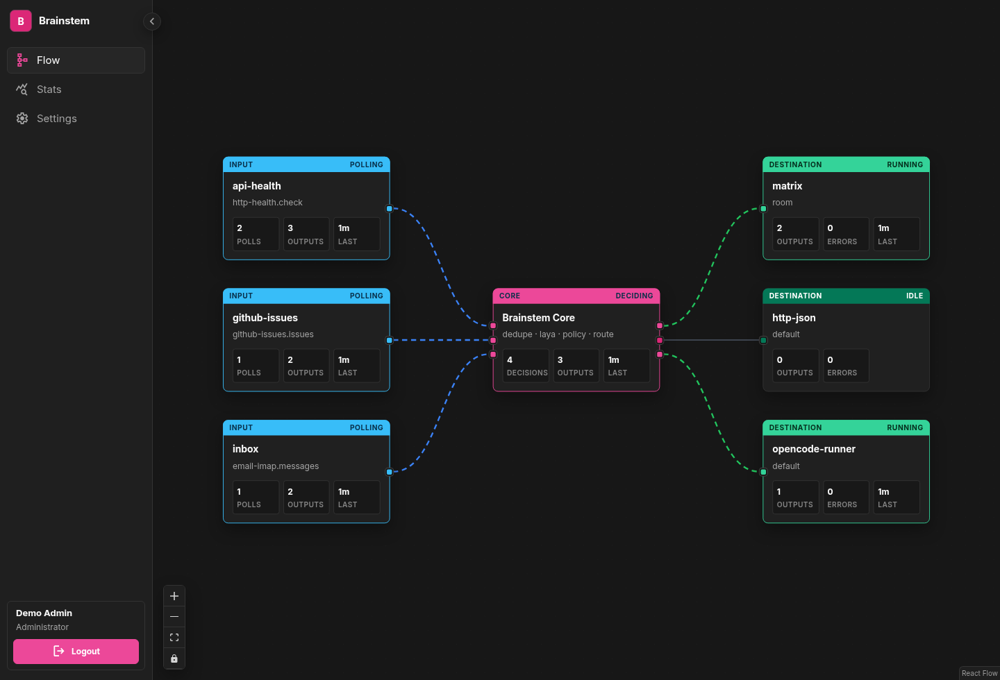
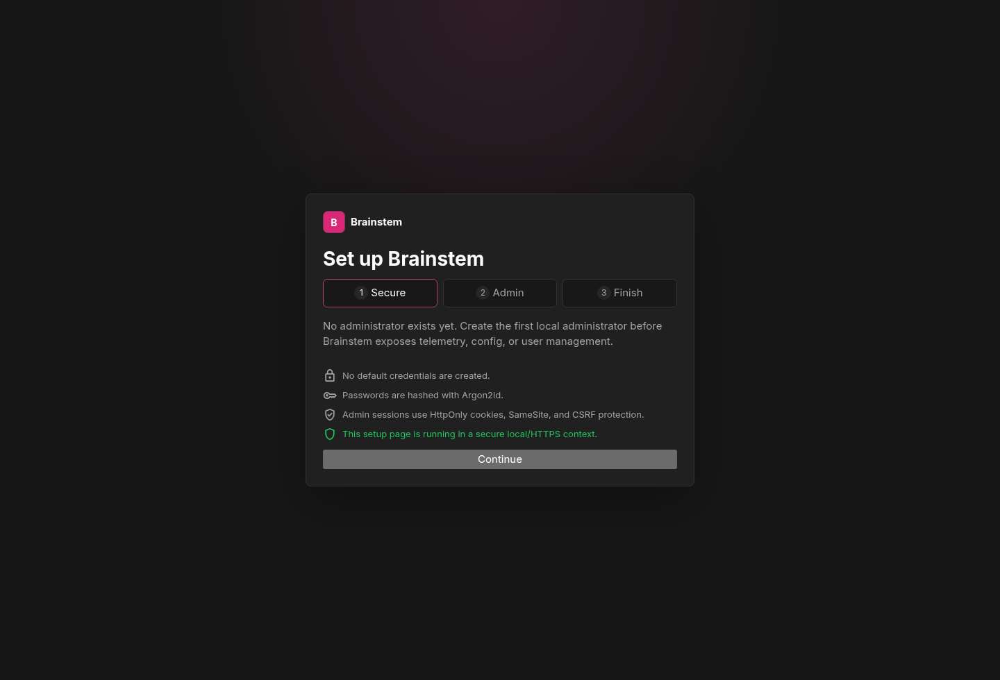
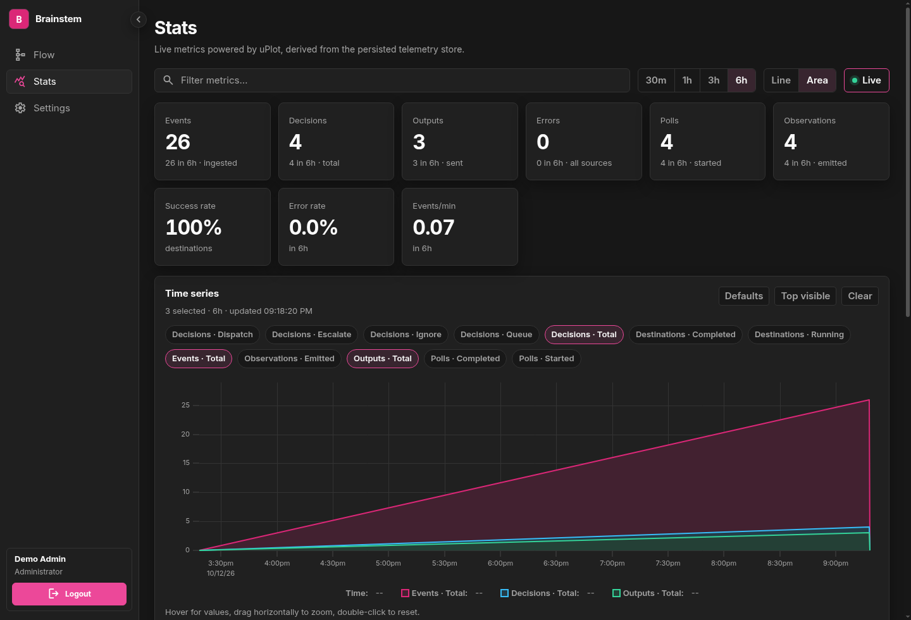
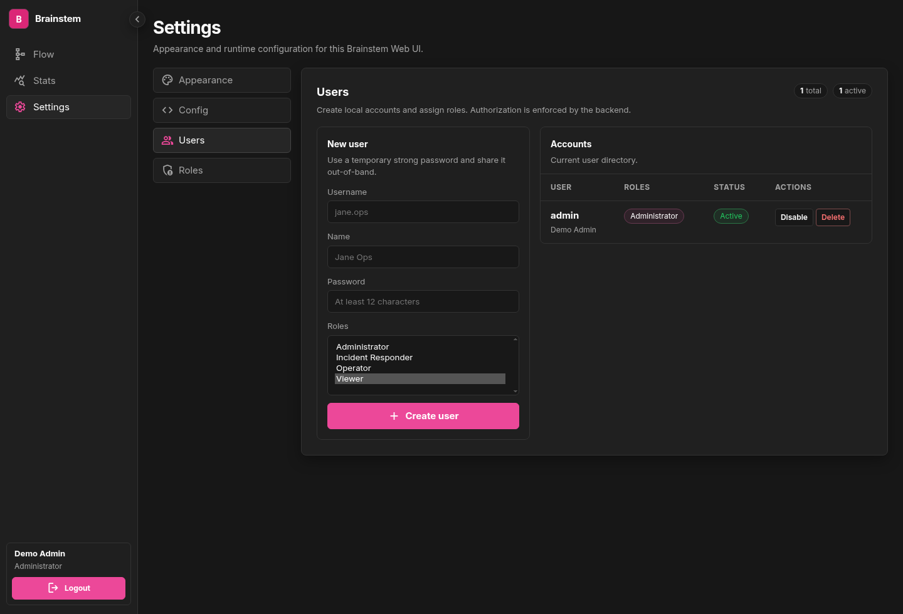
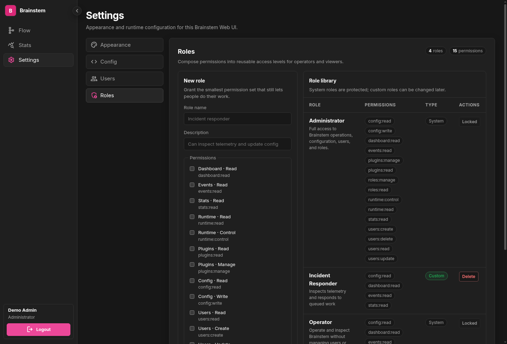

# Brainstem

[](https://github.com/jurrebuunk/brainstem/releases/tag/v0.1.0)
[](LICENSE)
[](package.json)
[](CHANGELOG.md)
[](docs/input-plugins.md)

Brainstem is a local-first decision runtime for autonomous operations. It watches systems, normalizes observations, makes small bounded decisions locally, and only wakes people, automations, or agents when something actually needs attention.

> Keep expensive agents asleep until the signal is real.



## Why Brainstem exists

Most agent systems start from a prompt. Brainstem starts from reality: health checks, issues, inboxes, certificates, webhooks, and other operational inputs. It turns noisy external state into durable decisions that can be routed safely.

Brainstem is designed to be:

- **Local-first** — runs as a Node process with SQLite; no hosted control plane required.
- **Headless by default** — the runtime owns polling, decisions, routing, checkpoints, records, and telemetry.
- **Observable** — backend API persists event history, stats, live SSE, and raw envelopes.
- **Secure enough to leave running** — first-run admin setup, Argon2id passwords, persistent sessions, CSRF protection, RBAC, and optional machine bearer tokens.
- **Plugin-shaped** — inputs observe the world; destinations notify, log, post, or start an agent runner.
- **Simple to operate** — one repo, one image, one SQLite-backed runtime; no queue, broker, or microservice stack required.

## Product shape

```text
Inputs                         Brainstem Core                    Destinations
------                         --------------                    ------------
HTTP health ─────────────┐     checkpoints/dedupe ─┐             Matrix room
GitHub issues ───────────┼──▶  Laya signals        ├──▶ route ─▶ HTTP JSON / Web UI
Email / IMAP ────────────┤     policy thresholds   ┘             opencode runner
TLS certificates ────────┘     SQLite records                    logs
```

The runtime emits structured telemetry to the backend API. The Web UI is presentation-only: it renders flow, history, stats, config, users, and roles from backend-owned state.

## Screenshots

### First-run onboarding

Brainstem ships without default credentials. The first visit creates the initial administrator through a guided setup flow.



### Persistent stats

Stats are derived from telemetry and stored in SQLite, so charts and counters survive UI restarts.



### Authenticated administration

Administrators can create, disable, and delete users; create and delete custom roles; and inspect backend-enforced permissions. Built-in roles are locked to preserve a safe recovery path.





## What Brainstem does

- Polls configured input plugins.
- Converts source data into standardized observations.
- Deduplicates source state with checkpoints.
- Deduplicates semantic decisions with durable SQLite records.
- Uses [Laya](https://github.com/receptron/laya) for bounded local decisions.
- Produces decision envelopes: `ignore`, `queue`, `dispatch`, or `escalate`.
- Routes decisions by level, route, source, and type.
- Sends matching decisions to destination plugins.
- Persists telemetry, event history, stats, sessions, users, and roles in SQLite.
- Exposes protected backend APIs and live SSE for the optional Web UI.

## Built-in plugins

Input plugins:

- `github-issues` — polls GitHub issues.
- `email-imap` — polls IMAP inboxes for new email.
- `http-health` — polls HTTP endpoints.
- `tls-certificate` — checks TLS certificate validity and expiry.
- `static-observations` — local smoke-test input.

Destination plugins:

- `log-decisions` — logs decisions to stdout.
- `matrix` — sends decisions to a Matrix room.
- `http-json` — posts output envelopes to an HTTP endpoint or the Brainstem backend.
- `opencode-runner` — starts matching work on an opencode server.

See the [plugin catalog](docs/plugins.md).

## Requirements

- Node.js `>=24`
- npm

Brainstem uses Node's built-in SQLite support. Node may print an experimental SQLite warning depending on the Node build.

## Quick start from source

```sh
git clone https://github.com/jurrebuunk/brainstem.git
cd brainstem
npm install
npm --prefix web install
cp brainstem.config.example.mjs brainstem.config.mjs
cp .env.example .env
```

Run the backend API and Web UI:

```sh
npm run api
WEB_BACKEND_URL=http://127.0.0.1:5174 npm run web
```

Open:

```text
http://127.0.0.1:5173
```

Create the first administrator in the onboarding flow. Then run the headless runtime in another terminal:

```sh
npm start
```

For a one-shot smoke test:

```sh
npm run start:once -- --all
```

## Recommended local config

Enable the backend API in `brainstem.config.mjs` so one runtime process owns telemetry and the API:

```js
export default {
  inputs: [
    {
      id: "api-health",
      module: "./plugins/http-health/index.mjs",
      input: "check",
      config: {
        name: "api",
        url: "https://example.com/health",
        timeoutMs: 10_000,
        expectedStatuses: [[200, 399]],
        failureThreshold: 3,
        recoveryThreshold: 2,
        minimumDecisionOnFailure: "dispatch"
      }
    }
  ],

  destinations: [
    {
      module: "./plugins/log-decisions/index.mjs",
      destination: "default",
      decisions: ["queue", "dispatch", "escalate"],
      routes: "all",
      sources: "all",
      types: "all",
      config: { prefix: "brainstem" }
    }
  ],

  runtime: {
    api: {
      enabled: true,
      host: "127.0.0.1",
      port: 5174,
      telemetryDbPath: "data/web-stats.sqlite"
    },

    records: {
      type: "sqlite",
      path: "data/brainstem.sqlite",
      pruneAfterDays: 90
    },

    checkpoints: {
      type: "json",
      path: "data/checkpoints.json"
    }
  }
};
```

When `runtime.api.enabled` is true and `runtime.telemetry.url` is not set, Brainstem sends telemetry to its own backend API automatically.

## Docker

The published image contains the headless runtime, backend API entrypoint, and production Web UI server.

```sh
cp brainstem.config.example.mjs brainstem.config.mjs
cp .env.example .env
cp docker-compose.example.yml docker-compose.yml
docker compose up -d
```

Open:

```text
http://127.0.0.1:5173
```

Direct one-shot run:

```sh
docker run --rm \
  --env-file .env \
  -v "$PWD/brainstem.config.mjs:/app/brainstem.config.mjs:ro" \
  -v brainstem-data:/app/data \
  ghcr.io/jurrebuunk/brainstem:v0.1.0 \
  node brainstem.mjs --once
```

Verify the image:

```sh
docker manifest inspect ghcr.io/jurrebuunk/brainstem:v0.1.0
```

See [`docs/docker.md`](docs/docker.md).

## NPM package

```sh
npm install -g @jurrebuunk/brainstem
brainstem --help
brainstem-api --help
```

Package binaries:

- `brainstem` — headless runtime.
- `brainstem-api` — standalone backend API.

## Runtime commands

```sh
npm start              # run continuously
npm run start:once     # poll each input once and exit
npm run start:once:all # poll once and also print ignored decisions through log destinations
npm run api            # start backend API on http://127.0.0.1:5174
npm run web            # start Web UI on http://127.0.0.1:5173
npm run web:build      # build production Web UI assets
```

Direct usage:

```sh
node brainstem.mjs --config ./brainstem.config.mjs --once
node brainstem-api.mjs --config ./brainstem.config.mjs --port 5174
```

## Web UI and backend API

The Web UI is optional and presentation-only. Backend endpoints own all state:

```text
POST   /api/events       telemetry/output ingest
GET    /api/events       persisted event history
GET    /api/stream       live Server-Sent Events
GET    /api/stats        persistent counters and time series
GET    /api/config       read editable config
PUT    /api/config       syntax-check and write config
GET    /api/auth/status  setup/auth status
POST   /api/auth/setup   first administrator setup
POST   /api/auth/login   create session
GET    /api/auth/me      current user, roles, permissions, CSRF token
POST   /api/auth/logout  revoke session
GET    /api/users        list users
POST   /api/users        create user
PUT    /api/users/:id    update/enable/disable user
DELETE /api/users/:id    delete user
GET    /api/roles        list roles and permissions
POST   /api/roles        create role
PUT    /api/roles/:id    update role
DELETE /api/roles/:id    delete custom role
GET    /api/health       health check
```

Authentication and authorization:

- No default credentials.
- First-run setup creates the first Administrator.
- Passwords are hashed with the standard `argon2` npm package using Argon2id.
- Sessions are persistent SQLite records delivered with `HttpOnly`, `SameSite=Lax` cookies.
- State-changing requests require CSRF tokens.
- Built-in roles: Administrator, Operator, Viewer.
- Custom roles can be created/deleted; built-in roles are locked.
- The backend enforces permissions server-side. The UI only hides controls for convenience.
- Set `BRAINSTEM_COOKIE_SECURE=true` when serving over HTTPS.
- Set `BRAINSTEM_API_TOKEN` for machine telemetry ingestion if the API is reachable beyond localhost.

See [`docs/web-ui.md`](docs/web-ui.md) and [`docs/telemetry.md`](docs/telemetry.md).

## Durable state

Brainstem keeps durable state in local files:

- Core decision records: `data/brainstem.sqlite`
- Input checkpoints: `data/checkpoints.json`
- Backend telemetry/history/stats/auth: `data/web-stats.sqlite`
- Matrix notification state, if enabled: `data/matrix-notifications.json`

Retention controls:

```text
WEB_EVENTS_PRUNE_AFTER_DAYS  event history age cap; default 14
WEB_EVENTS_MAX_ROWS          event history row cap; default 50000
STATS_PRUNE_AFTER_DAYS       time-series age cap; default 14
```

Set a value to `0` to disable that pruning mode.

## Secrets and environment

Put secrets in `.env`, your shell, Docker Compose, or an orchestrator secret store. Do not commit them in config.

Common variables:

```text
GITHUB_TOKEN                 GitHub input token
EMAIL_PASSWORD               IMAP password
MATRIX_ACCESS_TOKEN          Matrix destination token
BRAINSTEM_API                set 1/true to enable backend API from env
BRAINSTEM_API_HOST           backend API host
BRAINSTEM_API_PORT           backend API port
BRAINSTEM_API_DB             telemetry/auth SQLite path
BRAINSTEM_API_TOKEN          optional machine bearer token
BRAINSTEM_COOKIE_SECURE      true when served over HTTPS
WEB_BACKEND_URL              Web UI backend API URL
WEB_BACKEND_TOKEN            optional proxy-forwarded machine token
BRAINSTEM_CONFIG             editable config path
```

## Writing plugins

Input plugins emit observations:

```js
import { defineInputPlugin } from "./src/sdk/index.mjs";

export default defineInputPlugin({
  apiVersion: "brainstem.input/v1",
  name: "my-input",
  inputs: {
    default: {
      mode: "poll",
      async *poll(ctx) {
        yield ctx.observation({
          id: "example:1",
          source: { type: "example", name: "demo" },
          type: "status",
          state: "open",
          title: "Example observation",
          message: "Something happened"
        });
      }
    }
  }
});
```

Destination plugins receive routed decisions:

```js
import { defineDestinationPlugin } from "./src/sdk/index.mjs";

export default defineDestinationPlugin({
  apiVersion: "brainstem.destination/v1",
  name: "my-destination",
  destinations: {
    default: {
      async handle(ctx, event) {
        console.dir(event.decision, { depth: null });
      }
    }
  }
});
```

Docs:

- [`docs/input-plugins.md`](docs/input-plugins.md)
- [`docs/destination-adapters.md`](docs/destination-adapters.md)
- [`docs/plugins.md`](docs/plugins.md)

## Project layout

```text
brainstem.mjs              headless runtime CLI
brainstem-api.mjs          standalone backend API CLI
src/core/                  decision engine and record stores
src/runtime/               plugin loading, routing, checkpoints, telemetry
src/backend/               backend HTTP API, telemetry, auth, stats, SSE, config
src/telemetry/             shared telemetry selectors and metric derivation
src/sdk/                   plugin author helpers
plugins/<name>/            built-in input and destination plugins
web/                       React Flow Web UI and static/proxy server
docs/                      user, plugin, and maintainer documentation
```

## Development

```sh
npm run check
npm test
npm run plugin:test
npm run web:build
npm pack --dry-run
```

Docs index: [`docs/README.md`](docs/README.md).

## Release

See [`docs/release.md`](docs/release.md).

## License

ISC
